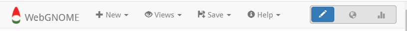

.. include:: links.rst

###################
Navigating WebGNOME
###################

Startup Modes
-------------

There are a number of ways to start using WebGNOME, depending on your use case.

Beginner Modes
..............

These modes require minimal setup and external data and are good for getting started with WebGNOME.

Weathering Only
    The Weathering Only mode provides a simple interface to quickly set up and explore the fate of an oil spilled in the open ocean, relatively far from shore.
    It models the spill as though it were in an infinite ocean with no land anywhere.

    This can be suitable for exploring the time scale of a spill -- how long will visible surface expression be present?
    As well as issues such as windows of opportunity for response -- how likely is this oil to be dispersible two days after the release?

    This mode makes it easy to set up the model to address these sorts of questions without requiring as many model inputs (e.g., currents and shoreline information).

Location Files
  A "Location File" is the WebGNOME model pre-configured to model scenarios in a particular location.
  These exist for many coastal United States waterways and contain shoreline data and currents. For more information see: :doc:`location_files`.
  
  The Location File mode will guide you through setting up a scenario with a series of questions.
  The exact questions depend on the specific region being modeled but may include questions about:
  wind conditions, river flow rates, circulation patterns, and the type of spill to be modeled.
  If you need help answering a question, click on the Location File Help button (:fa:`question-circle`) on the upper right of the form.
  

Intermediate Modes
..................

These modes require some expertise and may require gathering data and information from other sources.

Operational Forecasts
   This mode presents the user with a selection of operational oceanographic and meteorological forecast models that can be used to provide current and wind predictions (mostly US-centric models operated by NOAA or global models).
   Users can select a model to utilize results from and specify a regional bounding box and time span of interest.
   WebGNOME will then attempt to download the model output from the provider.
   This relies on connectivity to external servers which are outside the control of the WebGNOME application and errors can sometimes arise.
   Very large requests (large domains or time spans) also may not be supported.
 
Manual Setup
  Manual set up starts from scratch with an empty model -- users need to set up everything for the simulation:
  winds, currents, shorelines, etc. Each of these data files needs to be available and in the proper format.
  For more information about file formats, etc, see:
  |file_formats_doc|. Note, the inputs available through the Operational Forecast Mode can also be accessed in manual setup.

The Menu Bar
------------

No matter which way users begin setting up their scenario, the Menu Bar will be visible at the top of the page.
Use the Menu Bar to create a "New" model scenario, to "Save"
an existing model scenario, and to access help pages including this User Manual and information on recent updates.

Once the model scenario is setup, the output can be run as a spill animation or exported in various formats with the *Save* item in the menu bar. 

On the far right of the Menu Bar, there are several buttons for switching the WebGNOME "View".
The application begins in "Setup View". However, running the model requires switching the View.

 - To run the model and view the oil budget, switch to Fate View.
 - To run the model and view the oil trajectory, switch to Map View.
 - To make modifications to the model setup, return to Setup View.
 
.. image:: images/view_icons.png
    :align: center

Detailed information about the various Views is found in the next section.

Getting Help
------------

For detailed help information when entering information in forms or interacting with the various "Views", look for the embedded help icons (:fa:`question-circle`) on the upper right of the form or View. This will give information specific to the individual form or View. The User Manual is accessible through the Menu Bar *Help* item. 

Questions can also be sent to webgnome.help@noaa.gov.
