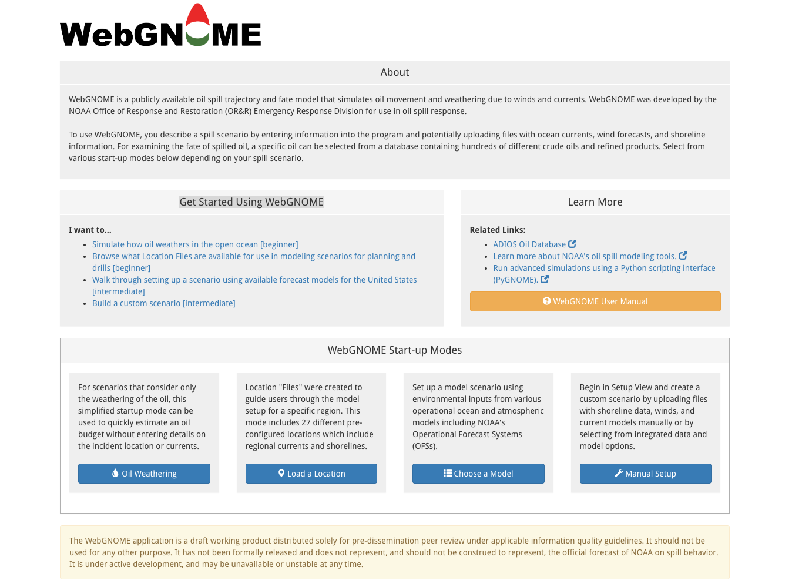

.. include:: links.rst

.. |br| raw:: html

   

###############
Getting Started
###############

|br| 
The |Landing Page| (shown below) provides a launching point for different WebGNOME applications.

|br| 
It links to the following WebGNOME start-up modes:

- Oil Weathering Only (|Beginner Mode|) 
- Load a Location (|Beginner Mode|)
- Choose a Model (|Intermediate to Advanced Mode|) 
- Manual Setup (|Intermediate to Advanced Mode|) 

These options can be accessed from the |Manual Setup Start-up Mode|, which looks like the image below.

.. image:: images/howto/setup_page.png
    :alt: WebGNOME Setup Page
    :align: center

|br| To create a new spill scenario, click on the **+New** menu dropdown menu and select one of the following options:

 - Location File Setup (|Beginner Mode|)
 - Weathering Only Setup (|Beginner Mode|)
 - Manual Setup (|Intermediate to Advanced Mode|)
 - Load Saved Model 

The Manual Setup is the most complicated.  Working through Location File Setup can help develop experience with the user inputs and is a good starting point for learning how to customize WebGNOME to a particular application via Manual Setup.  Whether you want to become familiar with WebGNOME through exercises or to dive right into Manual Setup, these resources might help you get started.

- :doc:`how_to_location`
- :doc:`how_to_manual`

Examples of these two cases can also be found in:

- :doc:`transport_exercises/location_file_exercise`
- :doc:`transport_exercises/manual_exercise`
