.. include:: links.rst

.. |br| raw:: html

   

####################################
Getting Started with  Location Files
####################################
Location Files contain pre-packaged information about the tides, currents, and shorelines for a specific region.  They can be accessed in two ways: (1) from the `Manual Start-up Mode`_, and (2) from the `Location Files Start-up Mode`_ page.  

.. _Manual Start-up Mode:

Location File Selection from Manual Start-up Mode
=================================================
To select a location file from |Manual Setup Start-up Mode|, click on the "+New" drop down menu and select "Select a Location File"

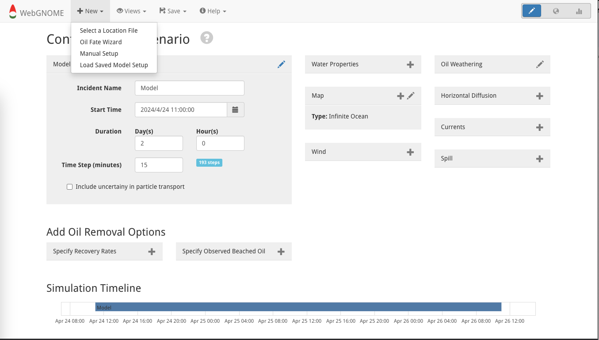

A pop-up window will explain that starting a new model setup will delete the existing one to give an opportunity to save the existing model setup, if needed.  If no save is needed then just click "OK".

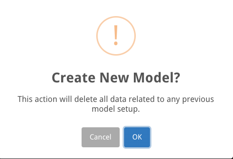

|br| |br| |br| |br| |br| |br| |br| |br| |br|

The "Location Files" page will pop up.  Proceed as follows. 

.. _Location Files Start-up Mode:

Location Files Page Start Up
============================
The |Location Files| page shows a map of locations to choose from

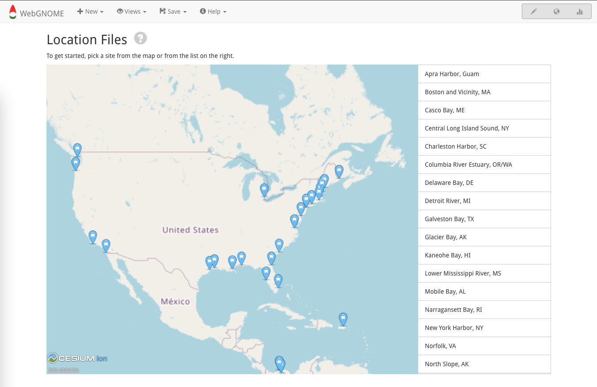

however, not all locations have the same information.  For more details on each location, please refer to the |Location Files| page.  On this page, you will see four cases with exploratory "Example Problems."  These four cases are the ones that we will focus on here.  **Note:  None of these scenarios should not be used in a predictive way to evaluate outcomes of a particular spill; rather, they provide a general sense of potential outcomes that will vary with realistic wind forcing and three-dimensional ocean circulation.**  

From this |Location Files| landing page, these curated scenarios can be accessed by selecting: 

 - Boston and Vicinity, MA
 - Mobile Bay, AL
 - Prince William Sound, AK
 - Strait of Juan de Fuca, WA
 
Step-by-step instructions are provided below for "Boston and Vicinity, MA" while explanations for the other three are given.  An additional "Columbia River Estuary Example Problem" is also explained.  

Boston and Vicinity, MA (winds, tides, river discharge, and effluence)
----------------------------------------------------------------------
This exercise explores how winds, tides, and river discharge can affect transport as well as the potential influence of effluence.  It also highlights differences between "Best Estimate" and "Uncertainty" solutions.

Once on the |Location Files| landing page, load the "Boston and Vicinity, MA" exercise by selecting "Load Location."  

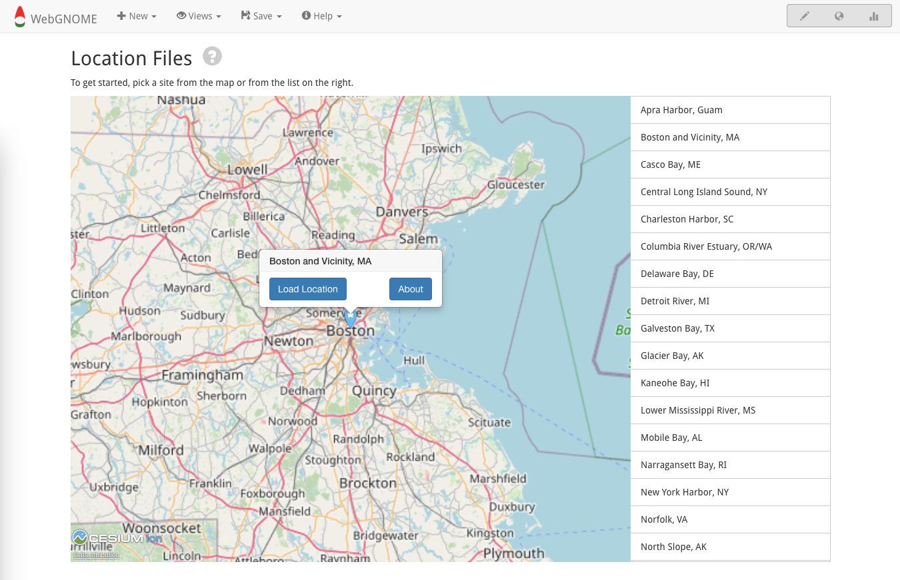

A "load" option is also available on the menu bar to the right and will show up when the cursor is hovered over the "Boston and Vicinity, MA" selection.  This is the only load option available after selecting to learn more about this case by choosing |About Boston| in the previous step.  

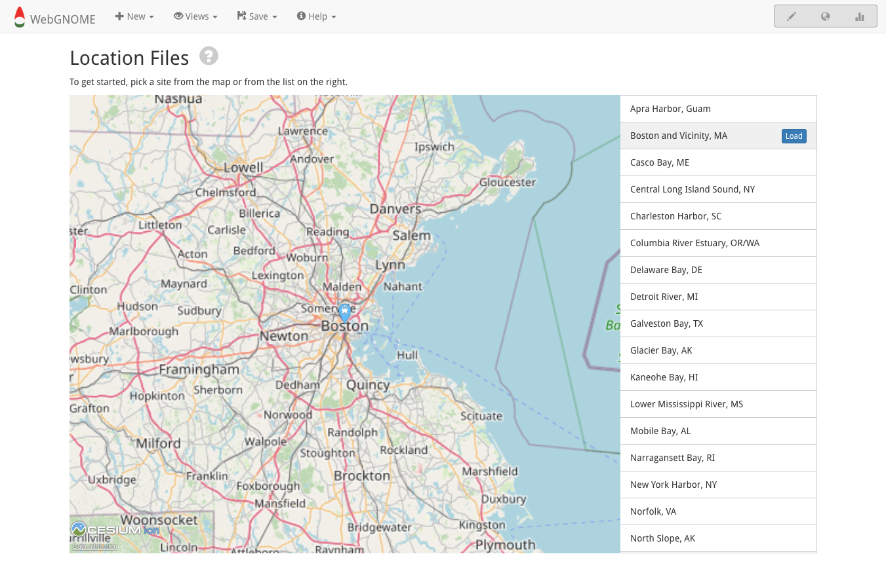

Follow the instructions in the |About Boston| page to fill in the spill specifications.  The first step is to establish some basics of the model run.  

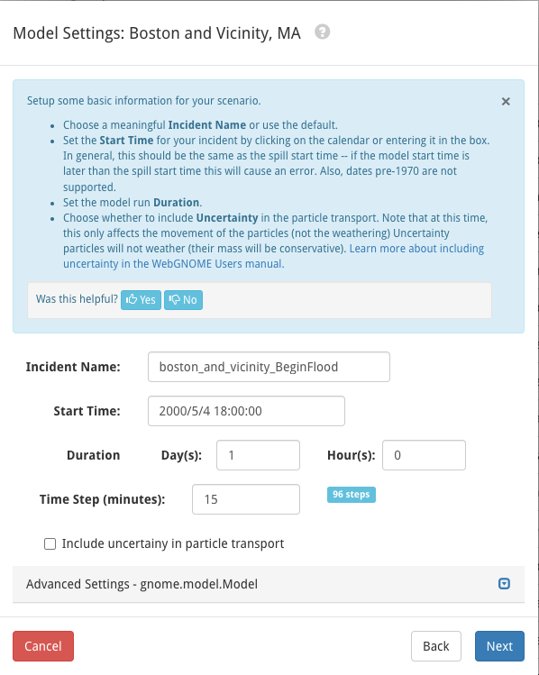

In this example, we are not considering the influence of effluence.

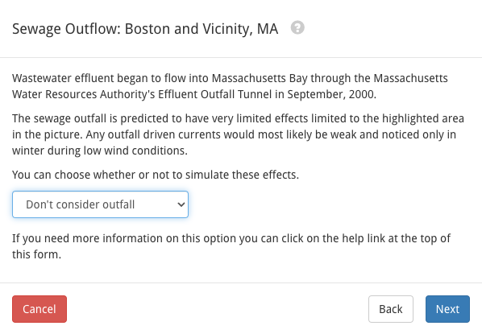

Next, we specify winds

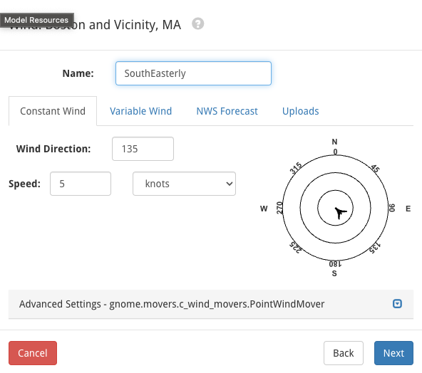

and spill type

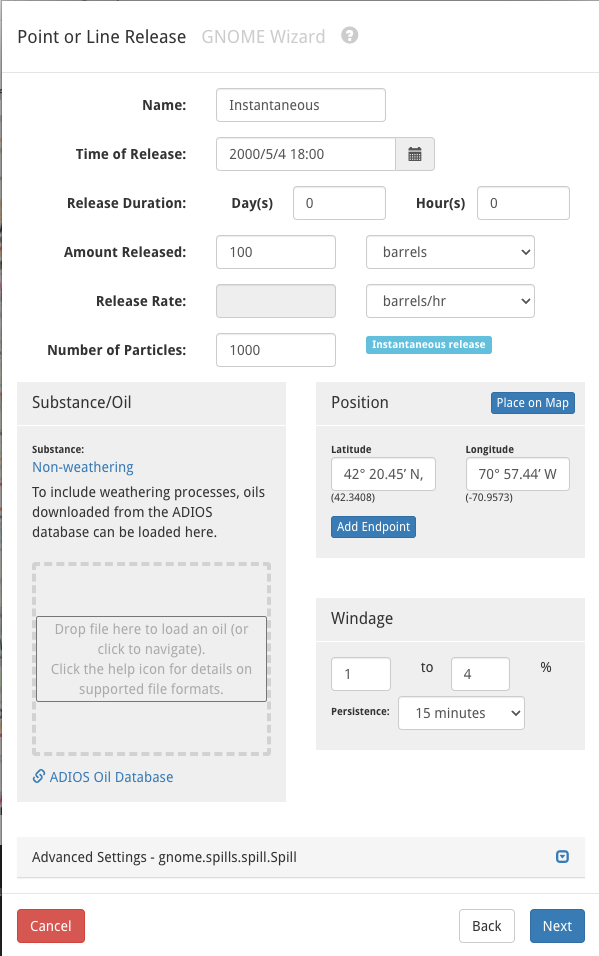

Now comes the fun part: click "Run Model"!  The model will run as soon as the Map View opens, so it is worth noting these different view options. 

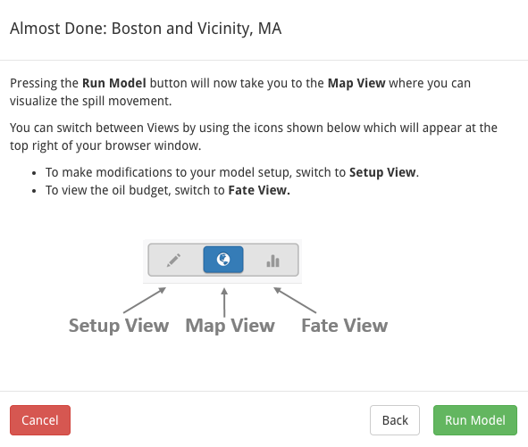

In this case, the Fate View won’t offer information because we have selected “no weathering.”  If you're interested in a case with oil types, the |Prince William| exercise includes an exploration of using different oil type; however, oil weathering can be added to any of these examples (as explained below in `Add Oil Type Section`_).

.. |Prince William| raw:: html

   <a href="https://gnome.orr.noaa.gov/doc/location_files/prince_william_sound_examples.html#prince-william-sound-examples" target="_blank">
   The Prince William Sound, AK</a>

“Run Model” will produce the following result. 

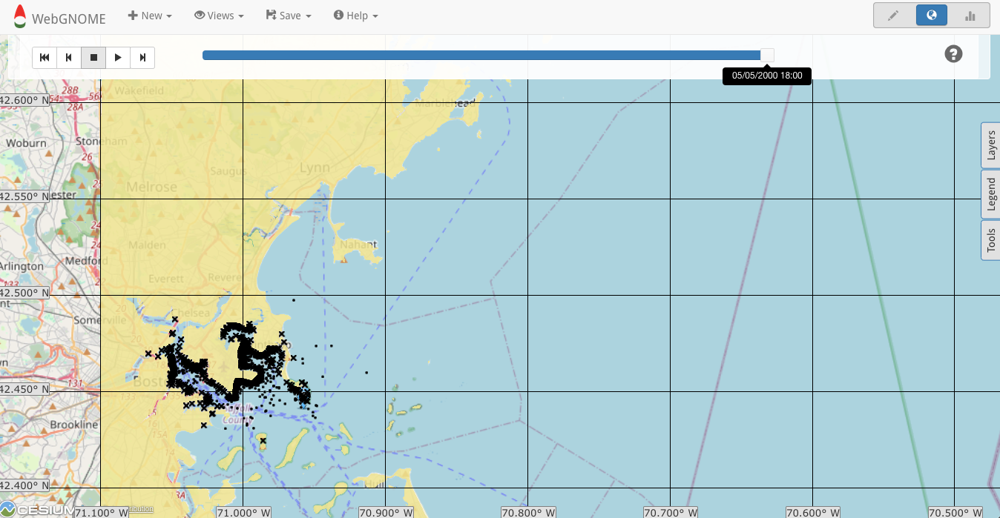

The scrollbar at the top can be used to change the view time and the play arrow in the upper left can be used to re-start the model.  In addition to the changing the model specifications with the “Setup View” (as previously shown), the three tabs on the right provide additional options for changing the map view. 

Congrats!  You have officially run WebGNOME!  

Mobile Bay, AL (wind and river discharge)
-----------------------------------------
This exercise examines how winds and river discharge affect transport in this region. It also highlights differences between "Best Estimate" and "Uncertainty" solutions.

Prince William Sound, AK (wind and oil type)
--------------------------------------------
This exercise explores how wind direction and oil type influences oil trajectory and fate in this region.  It also highlights differences between "Best Estimate" and "Uncertainty" solutions.

Strait of Juan de Fuca, WA (winds, current reversals, and tides)
----------------------------------------------------------------
This exercise shows how winds, current reversals, and changing tides influences oil trajectory.  It also highlights differences between "Best Estimate" and "Uncertainty" solutions.

.. _Add Oil Type Section:

Add Oil Type
============

Select "GNOME Compatible" in the |adios_db| and download a .json file.  For example, Alaska North Slope Crude options are as follows.

.. image:: images/howto/gnome_compatible_adios.png
    :alt: gnome compatible oil type
    :width: 500
    :align: center

Once the oil type is selected, the .json file can be downloaded with the download button in the upper left.  

.. image:: images/howto/download_adios_json.png
    :alt: download oil type
    :width: 500
    :align: center

This file can be loaded into WebGNOME as part of the "Spill" specifications, as shown below for a "Point or Line Release."

.. image:: images/howto/add_oil.png
    :alt: add oil for weathering
    :width: 400
    :align: center

Note: The |adios_db| can be accessed directly from within WebGNOME via the link at the bottom of the "Substance/Oil" box, eliminating the need to download a file. 
