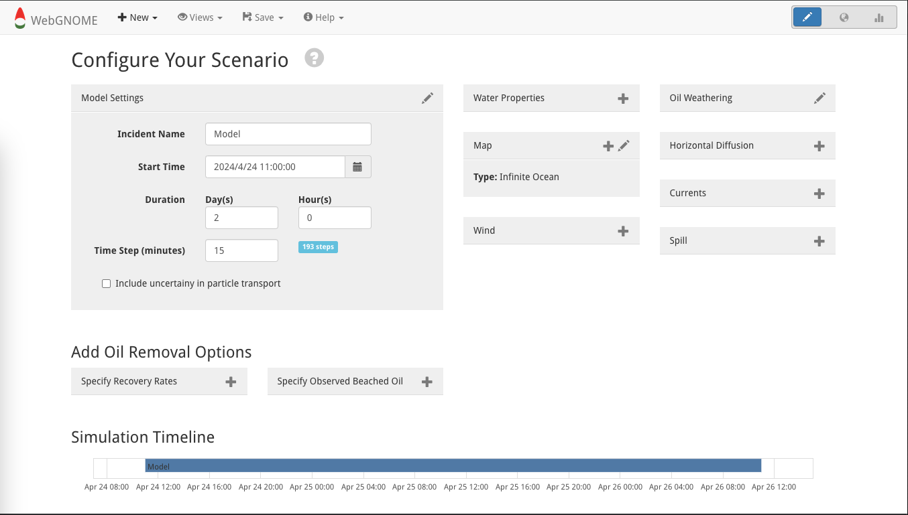
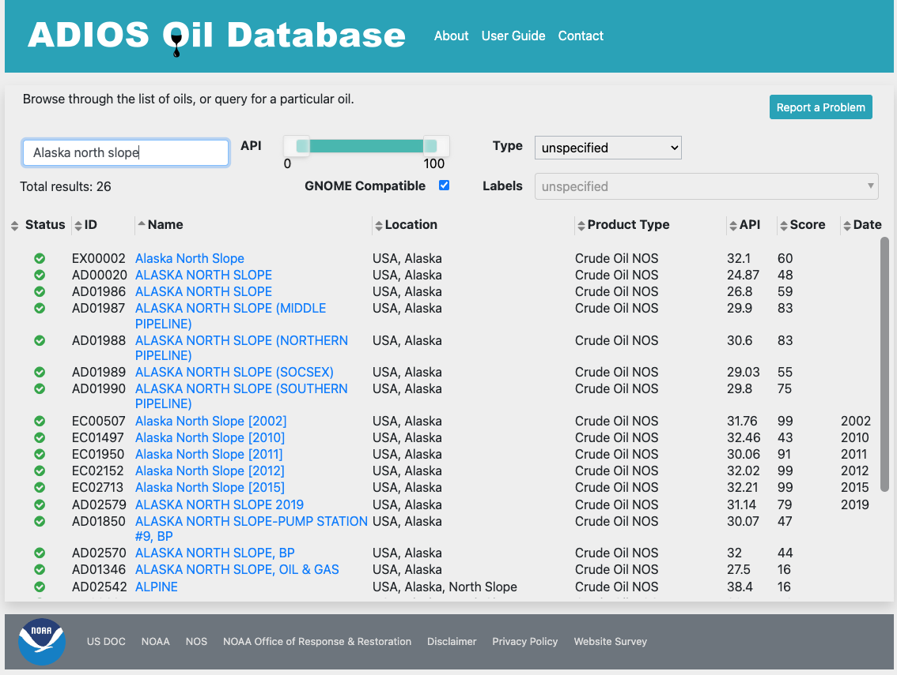
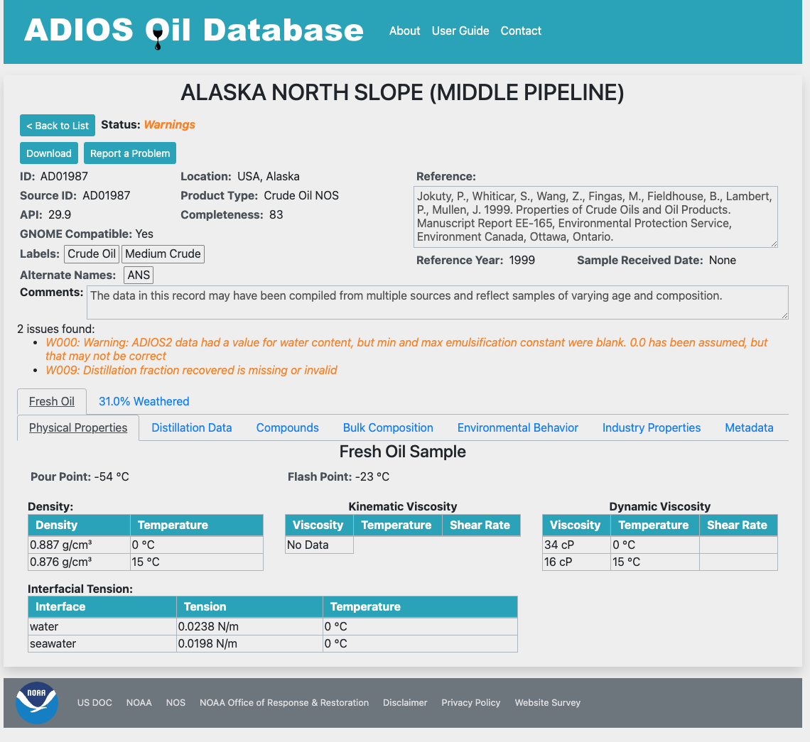
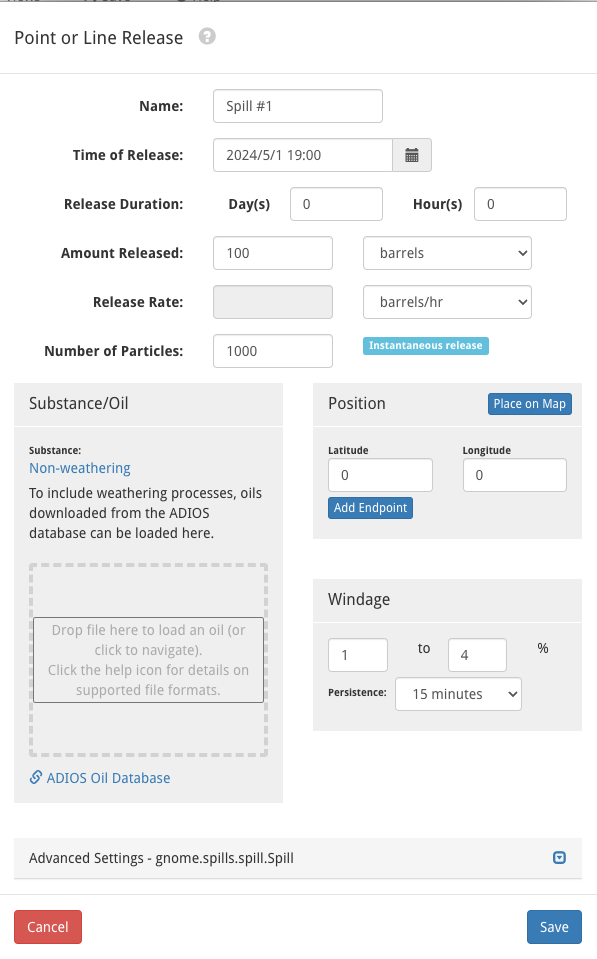

.. include:: links.rst

.. |br| raw:: html

   

####################################
Getting Started with a Manual Setup
####################################
The Manual Setup Start-up Mode is the best way to customize WebGNOME to answer questions related to your particular spill scenario(s).  The |Manual Setup Start-up Mode| looks as follows. 

It can be returned to at any time by clicking the pencil icon in the upper-right corner.  Once the spill scenario is configured, this page will look something like:

.. image:: images/setup_view.png
    :alt: configured setup
    :align: center

The following sections explain the different configuration boxes that tailor WebGNOME to a particular application.  
 
Model Settings
==============

This panel is configured with a default start date of "now" (in the users time zone), a simulation duration of 2 days, and a time step of 15 minutes. These options can be edited directly in the panel or by clicking on the Setup View pencil icon.

The time step specification is an important consideration as it impacts both the simulation run time and accuracy of of the model output. A smaller time step may be needed when the input currents are on a high resolution grid or the velocities are strong. However, decreasing the time step will also increase the time that is necessary to run the model simulation.

This panel also includes the option to activate Uncertainty in the simulation (see :doc:`uncertainty`).

Spill
=====

WebGNOME has various options for initializing spills either as a point source, a line source or over an area (polygons). Spills can also be instantaneous (particles are released all at once) or continuous over a specified duration. Clicking on the Spill configuration box will bring up a menu with selections for different spill options. See the specific help in the form for more information on spill types and file formats.

Add Substance/Oil
-----------------

Select "GNOME Compatible" in the |adios_db| and download a .json file.  For example, Alaska North Slope Crude options are as follows.

Once the oil type is selected, the .json file can be downloaded with the download button in the upper left.  

This file can be loaded into WebGNOME as part of the "Spill" specifications, as shown below for a "Point or Line Release."

Note: The |adios_db| can be accessed directly from within WebGNOME via the link at the bottom of the "Substance/Oil" box, eliminating the need to download a file. 

Map
===

A map is necessary to determine when particles interact with the shoreline (e.g. oil beaching). Clicking on the Map configuration box will yield several options -- you can choose to upload a file (see the help in the load form for more information on supported file formats). Alternatively, there is an option to download shoreline data for a specified region (*Custom Shoreline*). In idealized cases, you can also opt for an *Infinite Ocean* with no shorelines.

Winds
=====

Wind is also a required element for modeling surface transport. Options include loading output from a meteorological model (*Load NetCDF winds*) and creating or loading a *Point Wind* (a time series at a point which is applied constantly over the domain).

There are multiple options for adding Point Winds:

* Information can be entered manually as a constant wind value or as a time-series.
* The latest point forecast can be automatically imported from the National Weather Service (NWS) for a specified location.
* An existing file can be uploaded.

Finally, the *Select Wind for Specified Region* option provides a direct connection to retrieve wind forecasts directly from supported operational models. 

.. admonition:: A Note on Meteorological Conventions

	When entering values use the convention adopted by meteorologists who define wind direction
	as the direction *from* which the wind is blowing. Also, wind speeds are assumed to be at a 10 meter
	reference height above the water surface.

Surface Currents
================

Surface currents are also important to consider when modeling surface transport. Although WebGNOME can be
run with wind driven transport only, realistic simulations generally need to also include surface currents.
Ocean current data on a regular, curvilinear, or triangular grid (e.g. output from a hydrodynamic model)
can be imported into WebGNOME. 

Currents can be added to be model either by uploading a file (*Load NetCDF Surface Currents*) or making a custom selection via the *Select Currents for Specified Region* option. This option provides direct access to download model output from numerous operationally available ocean models.

Horizontal Diffusion
====================

Spreading, i.e. diffusion, is included by a simple random walk algorithm.
The random walk is based on the diffusion coefficient which represents the horizontal
eddy diffusivity in the water. The model default is 100,000 cm^2/s. That value is appropriate for "typical" coastal ocean. You may want to adjust it to suit your scenario. Decreasing the diffusion value will result in less spreading of the oil as the oil is transported over time.  This will also tend to increase the surface concentrations that would be displayed within the spill trajectory maps as a result of the reduced spreading.

