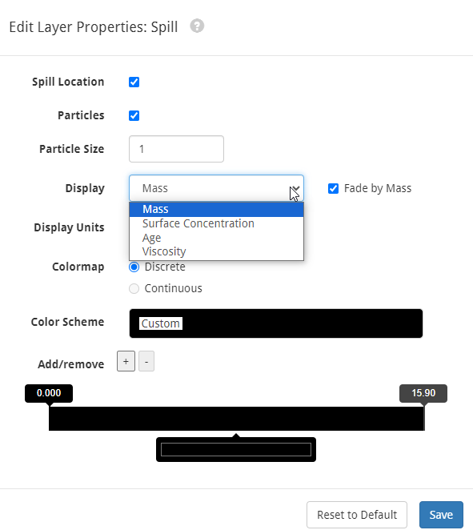
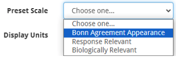
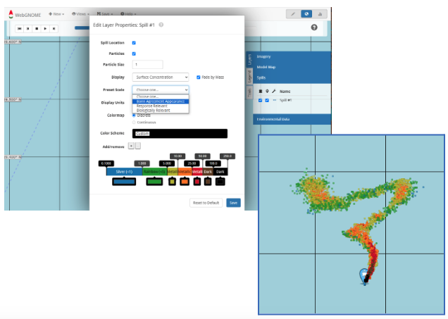

:orphan:

############################
Customizing Map View Display
############################

Coloring model particles based on properties
--------------------------------------------

.. |ThreeDots| image:: /images/ThreeDots.png

WebGNOME allows users to style the colors of particles in the trajectory output in order to show changes in different properties pertaining to the oil throughout the slick.

To access the customization options for the model particles display, under the Spills section of the Layers panel click the Configure icon (|ThreeDots|) next to the spill.

.. image:: images/SpillPanel.png
   :align: center

|

This brings up the Layer properties form for customizing the spill "layer".
By default the spill property that is displayed is set to Mass and all the particles are colored uniformly (black dots).

|

The "Display" pull down menu can be used to select other spill particle properties (mass, viscosity, surface concentration, or age).

When selecting to display a particle property other than Mass, the user should also select a scale style from the "Preset Scale" pull down menu. The selection of a particular scale is largely based on the user's preference.

|

Clicking on the "Color Scheme" bar allows for selecting various color options - either uniform or varying based on a property and bin sizes for color.

|
   
For more details, click the help icon (:fa:`question-circle`) at the top of the  “Edit Layer Properties” form.

