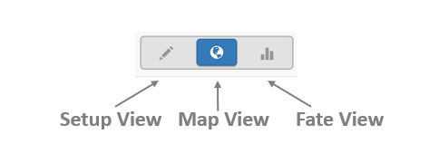
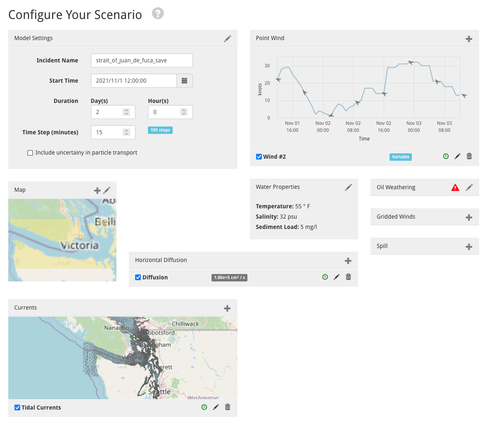
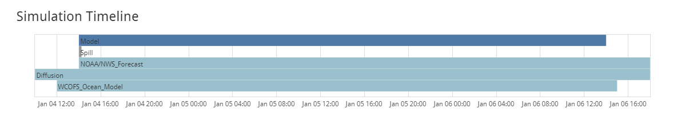
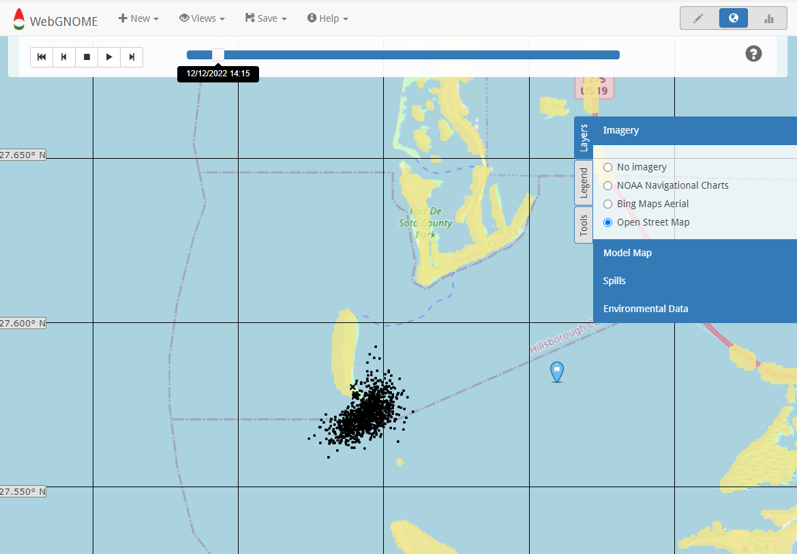
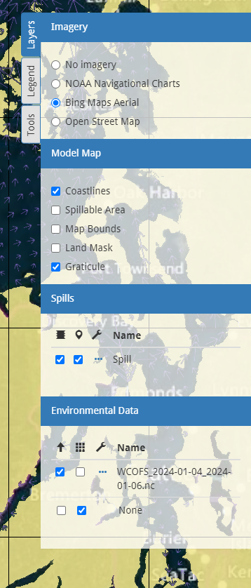
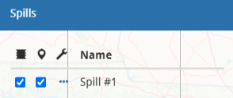
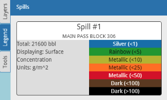
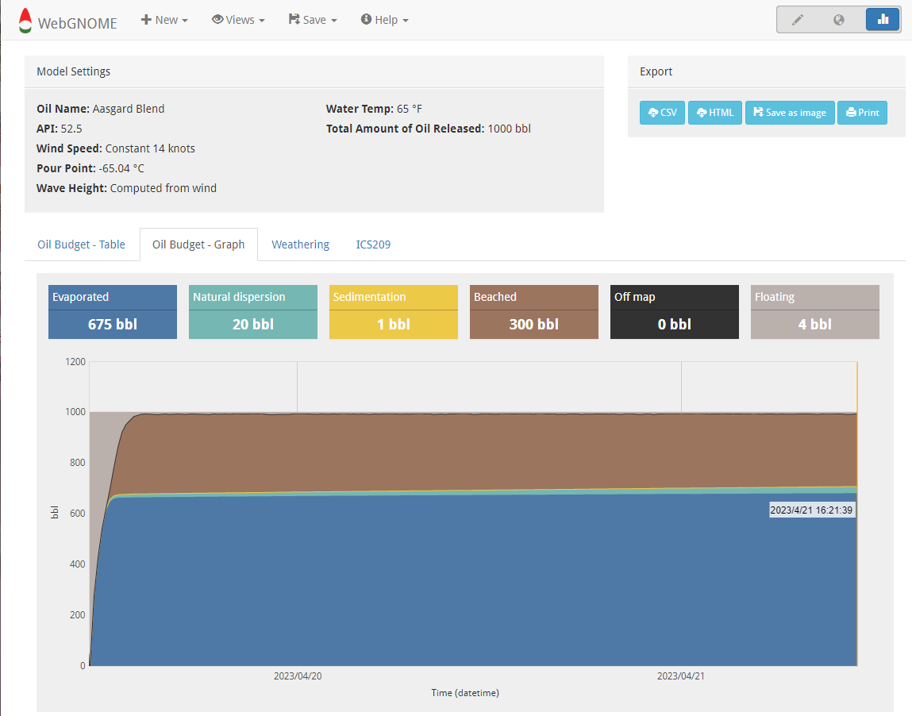

#####
Views
#####

The WebGNOME application has various "Views" for setting up the spill scenario and displaying the results of the simulation.
To switch between Views in the model, the icons
pictured below are always found on the top right of the Menu Bar. Alternatively, a selection can be made from the Views pull down option on the Menu Bar.

Setup View
----------

Setup view is used to interact with the various model components, e.g. the map, the "movers" (physical
forces like winds and currents which move the spill), and the "weatherers" (processes that 
change the mass or other physical/chemical properties of the spill). 

Within Setup View a number of panels can be used to enter or change basic model parameters (e.g. the model start time or run duration within the "Model Settings" panel) or to load or create movers (e.g. the "Wind" and "Current" panels). If a :doc:`Wizard<wizards>` is used to get started, 
these panels may be auto populated. Users can then use this View to make edits to the model parameters. 

**Note that if the model was initially set up using the Fate Wizard, clicking 
Setup View will return the user to that more simplified interface.**

The individual panels in Setup View have icons that can be clicked to create components (:fa:`plus`), edit components (:fa:`pencil`), and delete components (:fa:`trash`). In some panels, multiple components can be added. For example, there may be more than one data source for winds or currents available. Once created, components will show up in a list at the bottom of the panel. The Edit icon can then be used to modify parameters unique to that component (e.g. in the case of a wind or current, parameters include being able to extrapolate the data). The checkbox next to the component name is used to turn the component on/off in the model run. The clock icon (:fa:`clock-o`) shows whether
the data for the component's time range is valid (green), semi-valid (yellow), or invalid (red) when compared to the model simulation's time range. Hovering over the clock will also provide information on the time alignment.

Timeline Graphic 
================

The timeline at the bottom of the Setup View page is provided to help make sure movers and 
spills are in sync with the model run time. For example, when loading in data for currents 
or winds, this visual shows the start and end time for the data with respect to the model 
start and end times. It can be very useful for diagnosing model run time errors related to 
time mismatches.

Map View
--------

Map view is used to display the particles on a map. It has controls for controlling the animation playback and several pop-up panels available on the right hand side of the map (Layers, Legend, and Tools).

Layers Panel 
============

The Layers Panel is accessible from the right side of the map. This panel can be used to select map displays, customize the display settings for the particles (e.g., color the particles based on mass, surface concentration, viscosity, etc.), and display environmental information like surface currents.

The Panel contains four sections: 

	- **Imagery:** Allows selection of different background maps.
	- **Model Map:** Allows for display of map related information (e.g., map bounds) and toggling displays on and off.
	- **Spills:** Allows for customization of the displayed model particles.
	- **Environmental Data:** Allows display of model movers (e.g., current vectors).

To access the customization options for styling model particles, select the Spills section of the Layers panel, and click the Configure icon (|ThreeDots|) next to the spill.

.. |ThreeDots| image:: /images/ThreeDots.png

**Learn more:** :doc:`layers`

Legend Panel
============

The Legend Panel is accessible from the right side of the map. This panel can be used to display a legend pertaining to the properties you selected for display on the map. The Legend panel is particularly useful when the user has selected to display the particles based on surface concentration or viscosity.

    Shown here is the legend with the trajectory display set to surface concentration using oil thickness thresholds based on the BONN Agreement Oil Appearance Code (BAOAC)

Fate View
---------

This view displays the oil budget -- i.e., the amount of oil remaining on the surface versus the fraction evaporated and dispersed. Multiple panels can be selected to show the various weathering graphs.  

